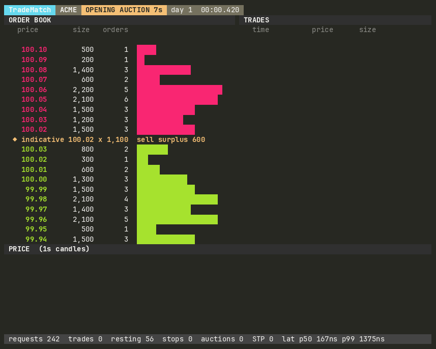

# TradeMatch Engine

[](https://github.com/AdrianTrill/TradeMatch-Engine/actions/workflows/ci.yml)
[](https://github.com/AdrianTrill/TradeMatch-Engine/actions/workflows/fuzz.yml)


[](LICENSE)

TradeMatch Engine is a compact C++ order matching engine built to demonstrate the core mechanics behind a price-time-priority exchange book. The project focuses on the matching loop itself: deterministic order handling, clean data structures, strong tests, and a repository layout that is easy to inspect.

Prices are represented as integer ticks rather than floating-point values. In the demo and tests, one tick equals one cent.

<p align="center">
  
</p>
<p align="center"><em>The <a href="#live-market-simulator">live market simulator</a>: trading agents on the engine, from the opening call auction into continuous trading (<code>make tui</code>).</em></p>

## Why It Is Interesting

This is the kind of systems problem that rewards precision more than size. A matching engine needs predictable behavior, strict sequencing rules, efficient cancellation, and a design that is easy to reason about under load. Even in a compact codebase, it exercises the same skills that matter in backend and low-latency systems work:

- data structure selection under performance constraints
- deterministic state transitions
- correctness-first handling of edge cases
- clear interfaces for testing, extensions, and instrumentation

## Supported Behavior

- Limit orders
- Market orders
- Stop and stop-limit orders, triggered by the last trade price, with cascades
- Iceberg orders that display one tranche at a time
- Time in force: GTC, DAY (with end-of-day expiry), IOC, and FOK
- Post-only orders that are rejected rather than take liquidity
- Self-trade prevention: cancel newest, cancel oldest, or cancel both
- Opening and closing call auctions with an indicative price and a single-price uncross
- Partial fills
- Price-time priority
- Trade execution reporting
- Cancel by order ID
- Replace by order ID, keeping time priority when only the quantity goes down
- Resting-order lookup by order ID
- Multiple instruments through `MatchingEngine`, with one book per symbol
- Market data: L2 depth updates, top of book, trade tape, OHLCV candles, VWAP, and a gap-free sequenced feed
- Machine-readable reject reasons for every rejected request
- Zero heap allocations on the request path once capacity is reserved
- A write-ahead journal of every command: CRC-32C-checked, about 20 bytes per order, and safe against torn writes
- Atomic snapshots, recovery from a snapshot plus the journal tail, and a 64-bit hash of the complete book state
- A multi-threaded gateway, matcher, and publisher pipeline over lock-free rings, with journal writes on an I/O thread
- An interactive command line, and scripted scenarios with golden transcripts for each matching rule
- An agent-based market simulator with full trading sessions, and a live terminal UI to watch it
- Deterministic benchmark/demo scenarios

## API Overview

Core public API:

- `submit(OrderRequest)` submits a new order and returns fills, remaining quantity, and any generated trades.
- `cancel(OrderId)` removes a resting order by ID and reports the cancelled quantity.
- `replace(OrderRequest)` modifies an active order. At the same price with the same or a smaller quantity, it amends in place and keeps time priority (`priority_kept`). Otherwise it cancels and resubmits under the same ID. The replacement must keep the side and the limit type, and use a time in force that can rest. Its quantity is the new open quantity.
- `expire_day_orders()` runs end-of-day processing: it cancels every resting or pending DAY order and returns their IDs.
- `has_stop_order(OrderId)`, `stop_order_count()`, and `last_trade_price()` expose the stop book and its trigger reference.
- `begin_auction()`, `indicative_auction()`, and `uncross()` run a call auction. `phase()` reports whether the book is trading continuously or collecting orders.

`OrderRequest` grows with optional fields, all defaulted, so `{id, side, type, quantity, price}` still works: `time_in_force`, `post_only`, `stop_price`, `display_quantity` (iceberg tranche), `owner`, and `self_trade_prevention`.
- `get_order(OrderId)` returns the current resting state for an active order.
- `get_orders_at_level(Side, Price)` exposes FIFO order state for a price level.
- `best_bid()` / `best_ask()` return the top of book, and `level_count(Side)` the number of price levels.
- `snapshot()` returns visible bid/ask levels for inspection and tests.

Results are plain values that never own heap memory:

- `trades` is a `std::span<const Trade>` over a buffer the book reuses, valid until the book's next `submit` or `replace`. Copy the trades out if you need them longer.
- `message` is a `std::string_view` of a static string.
- `triggered_stops` and `self_trade_cancels` are spans of the stop orders the request activated and the resting orders that self-trade prevention removed. `pending_trigger` and `self_trade_prevented` flag the corresponding outcomes for the request itself.
- `reject_reason` is a `RejectReason` enum for programmatic handling, for example `DuplicateOrderId`, `PostOnlyWouldCross`, or `InvalidDisplayQuantity`.
- `RestingOrderView` reports `remaining_quantity` (total open, including any hidden iceberg reserve), `visible_quantity`, `display_quantity`, `time_in_force`, and `owner`.

`OrderBook` takes an optional `BookCapacity` (orders, price levels per side, trades per call). Pools grow automatically, but sizing them for the expected peak keeps the request path free of allocator calls.

Minimal usage:

```cpp
tradematch::OrderBook book(tradematch::BookCapacity{.orders = 100'000, .price_levels = 4'096});

auto add = book.submit({1, tradematch::Side::Buy, tradematch::OrderType::Limit, 100, 10050});
auto replace = book.replace({1, tradematch::Side::Buy, tradematch::OrderType::Limit, 80, 10075});
auto cancel = book.cancel(1);
auto snapshot = book.snapshot();
```

### Multiple instruments and market data

`MatchingEngine` owns one `OrderBook` per symbol and routes requests by `SymbolId`. Requests for unknown symbols are rejected with `UnknownSymbol`. Attaching a `MarketDataListener` turns on market data for every book: after each request, a book reports the trades it executed, then one `LevelUpdate` per price level it changed, carrying that level's final displayed quantity and order count (0 means the level is gone). Because every changed level is reported with its final state, a consumer can keep an exact copy of the book's depth from the updates alone. With no listener attached, books skip the bookkeeping entirely.

`MarketDataFeed` is a ready-made listener that maintains, per symbol:

- a `DepthBook` replica (L2 depth) and top of book
- a tape of recent trades, the last price, traded volume, and VWAP
- OHLCV `Candle`s over a configurable interval, timestamped by the caller's clock (real or simulated)
- optionally, a log of `FeedMessage`s with gap-free sequence numbers, as a downstream feed handler would receive them

```cpp
tradematch::MatchingEngine engine;
tradematch::MarketDataFeed feed;
engine.set_listener(&feed);

const auto acme = engine.add_symbol("ACME");
feed.set_time(now_ns);
engine.submit(acme, {1, tradematch::Side::Sell, tradematch::OrderType::Limit, 100, 10050});

const auto top = feed.top_of_book(acme);              // best bid/ask with sizes
const auto depth = feed.depth(acme).levels(tradematch::Side::Sell, 5);
const auto& bars = feed.candles(acme).candles();      // OHLCV
```

```text
requests ──► MatchingEngine ──► OrderBook per symbol ──► BookListener ──► MarketDataFeed
                                 (zero-allocation core)   trades,          ├─ DepthBook (L2 replica) + top of book
                                                          level updates    ├─ trade tape, last price, volume, VWAP
                                                                           ├─ OHLCV candles
                                                                           └─ sequenced FeedMessage log
```

## Matching Rules

The engine follows standard price-time priority:

- Buy orders match the lowest available ask first.
- Sell orders match the highest available bid first.
- At the same price level, older resting orders fill before newer ones.
- Trades execute at the resting order's price.
- Market orders consume available liquidity and never rest in the book. Unfilled market quantity expires immediately.
- IOC orders trade what they can at their limit, and any remainder is cancelled instead of resting.
- FOK orders trade their full quantity immediately or do nothing. The engine sums level totals across the crossing price range before touching the book, so a killed FOK leaves no trace.
- Post-only orders are rejected with `PostOnlyWouldCross` if they would take liquidity. They must be limit orders with a time in force that can rest.
- DAY orders behave like GTC until `expire_day_orders()` runs.
- **Stops**: a buy stop triggers when the last trade price rises to its stop price, and a sell stop when it falls to it. A stop becomes a market order (`Stop`) or a limit order (`StopLimit`). Stops wait in a separate stop book and never appear in depth. A stop whose trigger is already met on arrival activates immediately. Triggered stops activate one at a time within the request that caused the trade. Each activation can trade, move the price, and trigger more stops, until nothing more triggers. On each side, the stop closest to the market goes first, then the earliest arrival. If both sides trigger at once, which can only happen on a book's first trade, the earlier arrival goes first. The request's `trades` include every cascaded trade.
- **Icebergs**: an order with `display_quantity` shows one tranche at a time. Depth and `visible_quantity` report only the tranche. When a tranche is consumed, the next one is displayed and joins the back of the queue with a new sequence number, so hidden quantity never jumps ahead of displayed orders. An aggressor can sweep through refreshed tranches at the same price in one request. Hidden quantity counts toward FOK.
- **Call auctions**: `begin_auction()` switches the book to a call phase, as exchanges do for the open and the close. Limit orders rest without matching, so the book may cross. Market orders queue for the uncross. IOC, FOK, and post-only orders are rejected with `NotAllowedInAuction`. `indicative_auction()` publishes the price, volume, and imbalance an uncross would produce. `uncross()` picks a single price using the standard exchange rules, applied in order: (1) maximize executed volume, (2) minimize the leftover surplus, (3) follow market pressure, taking the highest candidate if every candidate has excess demand and the lowest if every one has excess supply, then (4) take the candidate closest to the last trade price, preferring the lower price on a tie. It then pairs buyers and sellers at that price: queued market orders first, then by price and time, with iceberg reserves taking part. Unfilled market orders expire, continuous trading resumes, and any stops triggered by the auction price cascade. The residual book can never stay crossed: a remaining buyer and seller that crossed would raise the executable volume at some other candidate price, contradicting rule 1. The differential test asserts this after every operation.
- **Self-trade prevention**: when an incoming order with a non-zero `owner` reaches a resting order with the same owner, its `self_trade_prevention` setting decides. `CancelOldest` cancels the resting order and keeps matching. `CancelNewest` cancels the incoming remainder. `CancelBoth` does both. The FOK pre-check follows the same rules, so a FOK that would be stopped by its own order is killed before touching the book.
- Replace keeps time priority when it only reduces quantity at the same price, as exchanges do, because a smaller order cannot disadvantage the orders queued behind it. A price change or a larger quantity is cancel plus resubmit, so the order moves to the back of the queue at its new price.
- Replace may never change the side or the limit order type, or move to IOC or FOK. Rejected requests leave the resting order untouched.
- Aggregated quantities (price-level totals) are 64-bit, so they never overflow even when many large orders share a level.

## System Design

The matching core is intentionally single-threaded. That keeps sequencing deterministic and makes the behavior straightforward to test. Concurrency can be layered around the engine later, but the matching path itself should stay simple and predictable.

### Request Flow

1. Validate the incoming request.
2. Match against the best opposing price levels.
3. Emit trade records for each execution.
4. Either rest the remaining quantity, expire it, or remove it on cancel.
5. Expose the resulting state through lookup and snapshot methods.

### Core Data Structures

The book is index based: every structure is a flat array addressed by 32-bit slots, so nothing is allocated per order.

```text
 asks ladder (best at back)        price level (pooled)                 order nodes (pooled)
 ┌──────────┬────────┐            ┌────────────────────────┐          ┌───────┐   ┌───────┐   ┌───────┐
 │ 101.03   │ slot 7 │            │ price 101.01           │  head ──►│  #42  │◄─►│  #57  │◄─►│  #61  │◄── tail
 │ 101.02   │ slot 2 │            │ 900 shares, 3 orders   │          │  300  │   │  500  │   │  100  │
 │ 101.01   │ slot 4 │ ─────────► │ head slot, tail slot   │          └───────┘   └───────┘   └───────┘
 └──────────┴────────┘            └────────────────────────┘           intrusive FIFO list: time priority
   best ask ▲

 order index: open-addressing hash table, order ID ──► node slot (O(1) cancel and replace)
```

- **Order pool**: resting orders live in one `std::vector<OrderNode>` (48 bytes each) and are linked into an intrusive doubly linked FIFO list per price level. Freed slots go on a free list and are reused, so steady-state traffic never touches the allocator.
- **Price ladders**: each side keeps `{price, level slot}` entries in a vector sorted so the best price is at the back. Bids are ascending and asks descending. Taking or removing the best level is `pop_back`, joining the best price is a one-comparison fast path, and new levels, which usually appear near the touch, shift only a handful of entries.
- **Order index**: a purpose-built open-addressing hash table ([order_index.hpp](include/tradematch/detail/order_index.hpp)) with linear probing, Fibonacci hashing, and backward-shift deletion. It maps an order ID to its node slot in one or two cache lines, and heavy cancel traffic never leaves tombstones behind.
- **Trade buffer**: trades are appended to a reusable vector and returned as a span. The same applies to triggered-stop and self-trade-cancel lists.
- **Stop book**: pending stops live in their own pool and hash index. Each side has a vector sorted so the next stop to trigger sits at the back, so checking for triggers after a trade is O(1) per side.
- **Iceberg reserves**: each price level tracks displayed and hidden totals separately. Depth uses the displayed total, and FOK sums both without walking orders.

Cancel is O(1): an index lookup, then unlinking the node from its level. Only when a level empties does the ladder entry get erased.

### Design Tradeoffs

- The engine is single-threaded by design. That keeps sequencing deterministic and makes correctness easy to inspect. Concurrency belongs around the engine, in the gateway and market data layers, not inside the matching loop.
- The original engine (`std::map` levels, `std::list` queues, `std::unordered_map` index) is kept in [bench/baseline](bench/baseline) as the "before" in benchmarks. It was easy to read but allocated 1.83 times per operation, and those allocations dominated its tail latency.
- Sorted vectors beat trees for price levels because books are shallow and activity concentrates near the touch. The worst case (a new level deep in a very wide book) costs a short `memmove`, never an allocation.
- Rarely used features carry explicit hot/cold hints ([config.hpp](include/tradematch/detail/config.hpp)). Validation of stops, icebergs, and post-only, the FOK walk, self-trade handling, iceberg refresh, and stop processing are compiled out of line, and the small helpers that run on every request are forced inline. Without these hints, adding the features pushed `validate` and node removal out of line and cost about 18% throughput. With them, the features cost about 10% throughput, and the mean latency is within 1 ns of the engine without them.
- Returning trades as a span trades a small amount of API convenience (the view is invalidated by the next call) for zero allocations per request.
- Replace has two paths with explicit priority semantics. An in-place amend is O(1) and keeps the queue position. A price change or a size increase is cancel plus resubmit, which is easy to reason about and makes the priority reset visible in the result (`priority_kept`).

## Repository Layout

```text
.
├── .github/workflows/
│   ├── ci.yml
│   └── fuzz.yml
├── .clang-format
├── .clang-tidy
├── .editorconfig
├── CMakeLists.txt
├── Makefile
├── docs/assets/
│   └── tui.gif
├── include/tradematch/
│   ├── book_listener.hpp
│   ├── book_state.hpp
│   ├── cli.hpp
│   ├── detail/
│   │   ├── codec.hpp
│   │   ├── config.hpp
│   │   ├── file_io.hpp
│   │   ├── order_index.hpp
│   │   └── spin.hpp
│   ├── journal.hpp
│   ├── latency_histogram.hpp
│   ├── market_data.hpp
│   ├── matching_engine.hpp
│   ├── order_book.hpp
│   ├── pipeline.hpp
│   ├── simulator.hpp
│   ├── snapshot.hpp
│   ├── spsc_ring.hpp
│   └── types.hpp
├── src/
│   ├── cli.cpp
│   ├── codec.cpp
│   ├── file_io.cpp
│   ├── formatting.cpp
│   ├── journal.cpp
│   ├── market_data.cpp
│   ├── matching_engine.cpp
│   ├── order_book.cpp
│   ├── pipeline.cpp
│   ├── simulator.cpp
│   └── snapshot.cpp
├── bench/
│   ├── baseline/
│   │   ├── map_order_book.cpp
│   │   └── map_order_book.hpp
│   ├── benchmark_main.cpp
│   ├── journaled_book.hpp
│   ├── pipeline_main.cpp
│   ├── system_info.hpp
│   ├── workload.cpp
│   └── workload.hpp
├── tests/
│   ├── allocation_tests.cpp
│   ├── bench_tests.cpp
│   ├── cli_tests.cpp
│   ├── differential_tests.cpp
│   ├── journal_tests.cpp
│   ├── market_data_tests.cpp
│   ├── order_book_tests.cpp
│   ├── order_index_tests.cpp
│   ├── pipeline_tests.cpp
│   ├── scenarios/
│   │   └── *.tm, *.expected
│   ├── simulator_tests.cpp
│   └── support/
│       ├── differential.hpp
│       └── reference_book.hpp
├── fuzz/
│   ├── journal_fuzzer.cpp
│   ├── order_book_fuzzer.cpp
│   └── standalone_main.cpp
├── cmake/
│   └── replay_roundtrip.cmake
└── tools/
    ├── cli_main.cpp
    ├── demo_main.cpp
    ├── replay_main.cpp
    └── tui_main.cpp
```

## Build

Requirements:

- A C++20 compiler (GCC 11+, Clang 16+, Apple Clang 15+, or MSVC 19.30+)
- Optional: CMake 3.16+ if you want the CMake workflow

Fastest path:

```bash
make
```

The Makefile compiles each source file to an object with generated dependency files, so editing a header rebuilds exactly the objects that include it.

CMake alternative:

```bash
cmake -S . -B build -DCMAKE_BUILD_TYPE=Release
cmake --build build
```

CMake options:

| Option | Default | Effect |
| --- | --- | --- |
| `TRADEMATCH_WARNINGS_AS_ERRORS` | `OFF` | Promote compiler warnings to errors (`-Werror` / `/WX`), as CI does |
| `TRADEMATCH_SANITIZERS` | empty | Instrument every target, e.g. `address,undefined` or `thread` |
| `TRADEMATCH_COVERAGE` | `OFF` | Build with gcov instrumentation for coverage reports |
| `TRADEMATCH_LIBFUZZER` | `OFF` | Build the coverage-guided libFuzzer target (LLVM clang) |

Developer targets (the same checks CI runs):

```bash
make format        # apply clang-format
make format-check  # verify formatting without changing files
make lint          # clang-tidy with the repository's .clang-tidy rules
make sanitize      # build and test under AddressSanitizer + UndefinedBehaviorSanitizer
make tsan          # build and test under ThreadSanitizer
make coverage      # line/branch coverage of the engine, with an HTML report
```

`format` and `lint` use clang-format and clang-tidy 22.1.8, which CI pins. Install them with `pip install clang-format==22.1.8 clang-tidy==22.1.8`. Coverage uses `pip install gcovr`.

## Run

Demo:

```bash
./build/tradematch_demo
```

Command line (see [Command Line](#command-line)), live market simulator (see [Live Market Simulator](#live-market-simulator)), and journal replay (see [Journal, Snapshots, and Replay](#journal-snapshots-and-replay)):

```bash
make cli                                  # or ./build/tradematch_cli after a CMake build
make tui                                  # or ./build/tradematch_tui
./build/tradematch_tui --seed 42 --speed 4
make replay-demo                          # record a session's journal, replay it, and compare state hashes
```

Benchmark (see [Performance](#performance)):

```bash
./build/tradematch_benchmark                       # 1M measured operations, latency table + distribution
./build/tradematch_benchmark 500000                # custom measured operation count
./build/tradematch_benchmark --seed 7 --json out.json
```

Tests:

```bash
make test
```

If you build with CMake instead:

```bash
ctest --test-dir build --output-on-failure
```

## Command Line

`tradematch_cli` is an interactive front end to the engine, with commands that read like order tickets:

```text
$ ./build/tradematch_cli
TradeMatch command line. Type help for the commands, quit to leave.
> add ACME
added ACME
> sell 300 @ 100.10 display=100
ACME #1 SELL 300 @ 100.10 display 100 -> resting 300
> sell 200 @ 100.25
ACME #2 SELL 200 @ 100.25 -> resting 200
> buy 150 @ 99.90
ACME #3 BUY 150 @ 99.90 -> resting 150
> stop buy 100 @ 100.25
ACME #4 STOP BUY 100 @ 100.25 -> waiting for a trade at 100.25
> buy 350 @ 100.25 ioc
ACME #5 BUY 350 @ 100.25 IOC -> filled 350
  trade #1  100 @ 100.10  buy #5  sell #1
  trade #2  100 @ 100.10  buy #5  sell #1
  trade #3  100 @ 100.10  buy #5  sell #1
  trade #4  50 @ 100.25  buy #5  sell #2
  trade #5  100 @ 100.25  buy #4  sell #2
  stop #4 triggered
> book
ACME  CONTINUOUS  last 100.25  resting 2
              BID                       ASK
      99.90 x 150     (1)      100.25 x 50      (1)
```

| Command | Effect |
| --- | --- |
| `buy`/`sell [SYMBOL] QTY [@ PRICE \| market] [options]` | Submit a limit or market order |
| `stop buy\|sell [SYMBOL] QTY @ STOP [limit PRICE] [options]` | Submit a stop or stop-limit order |
| `cancel [SYMBOL] ID`, `replace [SYMBOL] ID QTY @ PRICE [options]` | Cancel or replace a resting order; a replace keeps the order's side, time in force, display size, and owner unless told otherwise |
| `book [SYMBOL] [LEVELS]`, `order [SYMBOL] ID`, `trades [SYMBOL] [N]` | Show the depth, one resting order, or the latest trades |
| `auction [SYMBOL] begin\|show\|uncross`, `expire` | Run a call auction, or the end-of-day expiry |
| `add SYMBOL`, `use SYMBOL`, `symbols`, `hash` | Manage instruments; print the state hash |
| `save FILE`, `load FILE`, `journal FILE` | Write or restore a snapshot; journal the session |

Options are `gtc`, `day`, `ioc`, `fok`, `post-only`, `display=N` (iceberg), `owner=N`, `stp=none|newest|oldest|both`, and `id=N`. The symbol can be left out once one is selected, prices take at most two decimals, and order IDs are assigned automatically unless `id=` sets one.

**Scenarios.** [tests/scenarios](tests/scenarios) holds a script for each part of the matching rules, together with its golden transcript:

| Scenario | Shows |
| --- | --- |
| [price_time_priority](tests/scenarios/price_time_priority.expected) | Better prices first, then arrival order; trades at the resting price |
| [order_types](tests/scenarios/order_types.expected) | Market sweeps, IOC, FOK, post-only, and DAY expiry |
| [amend_priority](tests/scenarios/amend_priority.expected) | Amending in place keeps priority; a bigger size or a new price resets it |
| [iceberg](tests/scenarios/iceberg.expected) | Tranches refreshing at the back of the queue |
| [stops](tests/scenarios/stops.expected) | Stop and stop-limit orders triggering |
| [self_trade_prevention](tests/scenarios/self_trade_prevention.expected) | All four modes |
| [auction](tests/scenarios/auction.expected) | A call auction: crossed book, indicative price, market-order priority, and the uncross |
| [errors](tests/scenarios/errors.expected) | Engine rejects and command line errors |

CTest runs every script and compares its transcript with the golden file line by line, on every platform. After an intended change in behavior, `tradematch_cli --update tests/scenarios/*.tm` regenerates the transcripts so the diff can be reviewed.

```bash
make cli                                          # interactive session
./build/tradematch_cli tests/scenarios/stops.tm   # print a scenario's transcript
make scenarios                                    # check every scenario against its golden transcript
```

## Live Market Simulator

`tradematch_tui` runs an agent-based market on the engine and draws it live in the terminal. The simulator ([include/tradematch/simulator.hpp](include/tradematch/simulator.hpp)) moves a fair value on a random walk with occasional news jumps. Four kinds of agents trade around it:

| Agent | Behavior |
| --- | --- |
| Market makers | Quote four levels per side around fair value with post-only DAY orders and re-price stale quotes with replace requests. They never quote through the opposite touch, so their quotes are never rejected |
| Noise traders | Post passive DAY and GTC orders behind fair value, cross the touch with IOC limits and market orders, and cancel |
| Momentum traders | Chase the trend with IOC orders when a fast moving average of the last price breaks away from a slow one |
| Whale | Works large icebergs that show 300 to 500 shares at a time, and parks stop and stop-limit orders 8 to 20 ticks beyond fair value |

Every simulated day is a full exchange session: an opening call auction, continuous trading, a closing call auction, then day-order expiry before the next open. During the auctions the screen shows the indicative price, matched volume, and surplus as orders arrive. Every agent order carries an owner and self-trade prevention, and the `STP` counter shows how often an agent would have traded with itself.

The screen shows ten levels of depth per side with size bars, the spread and mid, the trade tape with the aggressor side and auction prints, one-second candles, the session clock, and live counters. These include the engine's request latency (p50 and p99, market data publishing included).

A seed always replays the same market, on every platform. The standard library's random distributions produce different sequences with libc++, libstdc++, and the MSVC STL, so the simulator uses its own, and it is compiled without floating-point contraction (fused multiply-add). A golden-fingerprint test checks the stats and the entire book after a simulated day on Linux, macOS, and Windows in CI.

| Option | Default | Effect |
| --- | --- | --- |
| `--seed N` | `7` | Seed for the simulated market |
| `--speed X` | `1` | Simulated seconds per real second |
| `--fps X` | `15` | Frames per second |
| `--frames N` | `0` | Stop after N frames; 0 runs until Ctrl+C |
| `--record FILE.cast` | | Also write an [asciinema](https://asciinema.org) v2 recording |
| `--journal FILE` | | Journal every command, for [replay](#journal-snapshots-and-replay) |
| `--no-sleep` | | Render frames as fast as possible. Recordings keep their real-time pacing |
| `--headless` | | Don't draw, for recordings and the CTest smoke test |

To record a GIF like the one above with [agg](https://github.com/asciinema/agg):

```bash
./build/tradematch_tui --seed 7 --speed 2.5 --fps 12 --frames 330 --no-sleep --headless --record tui.cast
agg --font-size 14 --theme monokai --last-frame-duration 3 tui.cast tui.gif
```

`--journal FILE` records every command the session sends to the engine; see the next section.

## Journal, Snapshots, and Replay

The engine is deterministic: the same commands in the same order always produce the same trades and the same books. That makes event sourcing natural. `JournaledEngine` appends every state-changing command to a journal before applying it, and replaying the journal into an empty engine rebuilds exactly the same state. Rejected requests are journaled too, since replay rejects them in the same way.

```cpp
tradematch::MatchingEngine engine;
tradematch::JournalWriter journal("orders.tmj");  // creates the journal, or resumes an existing one
tradematch::JournaledEngine exchange(engine, &journal);

const auto acme = exchange.add_symbol("ACME");
exchange.set_time(now_ns);
exchange.submit(acme, {1, tradematch::Side::Buy, tradematch::OrderType::Limit, 100, 10050});
exchange.save_snapshot("orders.snapshot");  // optional: bounds recovery time

// After a restart: load the snapshot, then replay only the journal records after it.
tradematch::MatchingEngine recovered;
tradematch::recover(recovered, "orders.tmj", "orders.snapshot");
```

**Journal format.** A 24-byte header (magic, format version, first sequence number, and a CRC-32C) is followed by records: a 4-byte payload length, a CRC-32C of the payload, and the payload. A payload holds the command type, the timestamp as a zigzag varint delta from the previous record, and the command's fields as LEB128 varints. An order's side, type, time in force, post-only flag, and self-trade prevention mode share a single byte. A typical order takes 19 to 22 bytes, framing included. CRC-32C uses the CPU's CRC instructions where the build targets them (ARMv8, or x86 with SSE4.2) and a slice-by-8 table otherwise.

**Durability.** Appends never touch the heap. Each mode trades latency for what survives a crash:

| Mode | Records reach the operating system | Survives | Cost per request (Apple M4) |
| --- | --- | --- | --- |
| `Buffered` (default) | in 64 KiB batches | a clean shutdown; a crash loses the latest batch | about 14 ns |
| `Background` | in 64 KiB batches, written by an I/O thread | a clean shutdown; a crash loses the batches in flight (up to four) | about 12 ns, and no disk writes on the caller's thread |
| `Flush` | one `write` per record | a process crash | about 1.1 µs |
| `Sync` | one write per record, forced to stable storage (`F_FULLFSYNC` on macOS, `fsync` on Linux, `_commit` on Windows) | power loss | a drive cache flush, typically milliseconds |

**Crash recovery.** A crash in the middle of an append can only damage the end of the journal: it leaves a cut-off record, a final record whose payload never fully reached the disk, or zero-filled space. The reader treats exactly these as a torn tail and stops before it, and reopening the journal cuts the tail off, so appending continues the sequence cleanly. Damage anywhere else is corruption: the reader throws `JournalError` with the record number and byte offset rather than silently dropping every record after it.

**Snapshots.** `OrderBook::export_state()` returns a `BookState`: every resting order in queue order with its sequence number and iceberg reserve, the pending stops, the market orders queued for an auction, the trading phase, the last trade price, and the sequence and trade ID counters. That is everything that decides the book's future behavior, and nothing about how it is stored. `import_state()` rebuilds a book from a state, but only after checking that a book could actually reach it: sorted levels with none empty, queues in time priority, unique order IDs and sequence numbers below the next one to be issued, no crossed book outside an auction, and no stop that the last trade should already have fired. Otherwise it throws and leaves the book untouched.

A snapshot file holds every book's state and the journal sequence number it covers, protected by a CRC-32C. It is written to a temporary file, forced to disk, and renamed over the previous snapshot, so a crash leaves either the old snapshot or the new one, never a mix. `JournaledEngine::save_snapshot()` syncs the journal first. Otherwise a crash could leave a journal that ends before its snapshot, and new appends would reuse sequence numbers the snapshot already includes.

**State hash.** `state_hash()` fingerprints the canonical encoding of the complete state with 64-bit FNV-1a. Engines with equal hashes will behave identically from then on, which turns "did the replay work?" into a single comparison.

**Replay tool.** `tradematch_replay` rebuilds an engine from a journal, optionally starting from a snapshot. It verifies every record, then prints the replay speed, the command mix, the state hash, and each book:

```text
$ ./build/tradematch_tui --seed 5 --frames 300 --speed 8 --no-sleep --headless --journal session.tmj
simulated 02:42.000 over 2 day(s): 70,005 requests, 6,339 trades, 3 auctions
journal session.tmj: 70,013 commands, 1,543,445 bytes
state hash 0x280caf02de4bec9d

$ ./build/tradematch_replay session.tmj --depth 3 --expect-hash 0x280caf02de4bec9d
journal     session.tmj  1,543,445 bytes, records 1..70,013
replayed    70,013 commands in 3.8 ms  (18.59M commands/s)
            ADD_SYMBOL 1  SUBMIT 9,798  CANCEL 1,563  REPLACE 58,644  BEGIN_AUCTION 3  UNCROSS 3  EXPIRE_DAY_ORDERS 1
trades      6,339
state hash  0x280caf02de4bec9d
  ACME     CONTINUOUS  last 100.09  resting 665  stops 3
           bid 100.08 x 5,800 (18)       ask 100.09 x 2,100 (4)
               100.07 x 5,600 (21)           100.10 x 3,200 (12)
               100.06 x 6,000 (22)           100.11 x 3,200 (10)
verified    the replayed state matches the expected hash
```

`make replay-demo` runs exactly this, and CTest runs it on every CI platform. `--snapshot FILE` starts from a snapshot, `--save-snapshot FILE` writes one, and `--expect-hash` fails unless the replayed state matches.

## Multi-Threaded Pipeline

`Pipeline` puts the engine behind the order path of a real exchange: a gateway hands requests to a matcher thread, which publishes reports and market data to a publisher thread.

```text
                   requests                          events
 gateway thread ─────────────► matcher thread ─────────────────► publisher thread ──► your consumer
 (send)           SPSC ring    (owns the engine)    SPSC ring    (calls the consumer)
                                     │
                                     │ journal records, in 64 KiB batches
                                     ▼
                                 I/O thread ──► disk
```

```cpp
tradematch::PipelineConfig config;
config.symbols = {"ACME"};
config.journal = "orders.tmj";  // optional: journal every request, with an I/O thread doing the writes

tradematch::Pipeline pipeline(config, [](const tradematch::PipelineEvent& event) {
    // Runs on the publisher thread: one Report per request, after its Trade and LevelUpdate events.
});
pipeline.send({tradematch::CommandType::Submit, pipeline.symbol("ACME"),
               {1, tradematch::Side::Buy, tradematch::OrderType::Limit, 100, 10050}, /*request_id=*/1, now_ns});
pipeline.finish();  // drains both stages, joins the threads, and rethrows any failure from them
```

**Determinism.** Only the matcher touches the engine, so matching stays single-threaded, and the pipeline produces exactly the results of applying the same requests in order on one thread. The tests and the benchmark both check this.

**Lock-free rings.** The stages are connected by a bounded single-producer, single-consumer ring ([include/tradematch/spsc_ring.hpp](include/tradematch/spsc_ring.hpp)). Each side owns one index and publishes it with a release store, and the other side reads it with an acquire load; that is all the synchronization one producer and one consumer need. The producer's and consumer's fields sit on separate 128-byte cache lines, and each side caches the other's index, reloading it only when the ring looks full or empty. In steady state the two cores therefore share a cache line once per batch of messages rather than once per message. The matcher and the publisher also take up to 64 messages per pop, which spreads the cost of the atomics further.

**Waiting.** By default, an idle thread spins for about a microsecond and then yields its core, which suits a shared machine. With `WaitStrategy::Spin` it never yields, for the lowest and steadiest latency when every thread has a core to itself. On Apple silicon the threads also request the `USER_INTERACTIVE` quality of service, which keeps them on the performance cores; on Linux, pinning them to isolated cores is the operator's job. A full queue applies backpressure: the producer waits instead of dropping anything.

**Journaling off the matching thread.** With a journal, the matcher appends each request to an in-memory batch before applying it, and `Durability::Background` hands every full 64 KiB batch to an I/O thread. Four batch buffers circulate between the two threads through a pair of SPSC rings, so the matcher waits only if the disk falls four batches behind. After each batch, the I/O thread spins for 200 µs before parking, and the matcher sends a wake-up only when the I/O thread has actually parked. Both sides use sequentially consistent operations for that handshake, so no wake-up can be lost, and under load the matcher never makes a system call. Compared with writing each batch itself, this cuts the journaled engine's p99.99 from about 7 us to about 2 us (see [Journaling](#journaling)).

**Failures.** An exception on the matcher or publisher thread, such as a `JournalError` from a full disk or an exception from the consumer, is caught and rethrown by `finish()`. Meanwhile the failed stage keeps draining its queue, so the gateway never blocks.

**Benchmark.** `tradematch_pipeline_benchmark` sends the benchmark's order stream through the pipeline and times each request from the moment it was due to be sent until the publisher receives its report. Paced runs measure from the intended send time, so a stalled gateway shows up as latency instead of hiding it (no coordinated omission). Every run ends by checking the pipeline's book against a single-threaded replay of the same requests. On the Apple M4 (median of 5 runs, market data on, spinning threads):

| load | p50 | p90 | p99 | p99.9 | p99.99 |
| --- | ---: | ---: | ---: | ---: | ---: |
| 1M requests/s | 209 ns | 375 ns | 7.4 us | 29.7 us | 167 us |
| 5M requests/s | 225 ns | 425 ns | 52.2 us | 78.3 us | 109 us |

Unpaced, the pipeline sustains about 10 million requests per second end to end, and each request produces about 2.2 events: its report, trades, and level updates. The tail mostly reflects macOS, which can't pin threads to cores; isolated cores on Linux would tighten it.

```bash
make pipeline-benchmark                                          # 1M requests/s
./build/tradematch_pipeline_benchmark --rate 5000000 --journal pipeline.tmj
./build/tradematch_pipeline_benchmark                            # unpaced: maximum throughput
```

## Example Workflow

The demo executable (`./build/tradematch_demo`) walks through a deterministic scenario:

1. Two buy limit orders rest at 100.50.
2. Order 1 is reduced from 100 to 80 at the same price. It is amended in place and keeps its place at the front of the queue.
3. A sell order for 120 fills order 1 first (80), then order 2 (40).
4. A post-only ask rests at 101.00, and a post-only bid at 101.00 is rejected instead of trading.
5. A fill-or-kill bid for 80 is killed because only 50 is offered, and nothing trades.
6. A market order takes 40, and an IOC bid for 30 takes the last 10. Its remaining 20 is cancelled.
7. The leftover bid is cancelled by order ID.
8. An iceberg ask shows 20 of its 100 shares, and a buy stop waits at 101.50. A buy for 30 takes the first tranche and part of the next. Its trades at 101.50 trigger the stop, whose market order takes 30 more from the refreshed tranches.

Sample output excerpt:

```text
Replace order 1 side=BUY type=LIMIT qty=80 price=100.50
  replaced=true priority_kept=true previous_remaining=100
  Order quantity reduced in place; time priority kept.

Submit order 3 side=SELL type=LIMIT qty=120 price=100.50
  accepted=true filled=120 remaining=0 rested=false expired=false
  Order fully filled.
  trade#1 buy=1 sell=3 qty=80 price=100.50 aggressor=SELL
  trade#2 buy=2 sell=3 qty=40 price=100.50 aggressor=SELL

Submit order 5 side=BUY type=LIMIT qty=10 price=101.00 post_only
  accepted=false filled=0 remaining=10 rested=false expired=false reject=POST_ONLY_WOULD_CROSS
  Post-only order would take liquidity and was rejected.

Submit order 6 side=BUY type=LIMIT qty=80 price=101.00 tif=FOK
  accepted=true filled=0 remaining=80 rested=false expired=true
  Fill-or-kill order could not be filled in full and was cancelled.

Submit order 8 side=BUY type=LIMIT qty=30 price=101.00 tif=IOC
  accepted=true filled=10 remaining=20 rested=false expired=true
  Immediate-or-cancel order filled what it could; the remainder was cancelled.
  trade#4 buy=8 sell=4 qty=10 price=101.00 aggressor=BUY

Submit order 11 side=BUY type=LIMIT qty=30 price=101.50
  accepted=true filled=30 remaining=0 rested=false expired=false
  Order fully filled.
  trade#5 buy=11 sell=9 qty=20 price=101.50 aggressor=BUY
  trade#6 buy=11 sell=9 qty=10 price=101.50 aggressor=BUY
  trade#7 buy=10 sell=9 qty=10 price=101.50 aggressor=BUY
  trade#8 buy=10 sell=9 qty=20 price=101.50 aggressor=BUY
  triggered stop order 10
```

## Tests Included

The test suite covers deterministic scenarios that matter for correctness:

- exact match
- partial fill with resting remainder
- multiple matches across price levels
- price-time priority at the same price
- cancel order
- replace order priority reset
- replace rejecting side or order-type changes
- 64-bit price-level totals that do not overflow
- unmatched order resting in the book
- market-order expiry of any unfilled remainder
- invalid and duplicate-order rejection
- replace that crosses the book and fills immediately
- lookups for missing price levels and unknown order IDs
- price formatting at the extremes of the 64-bit range
- best bid / best ask tracking as levels are consumed and cancelled
- reject reasons for every validation failure, unknown order, and illegal replace
- amend-down keeping time priority, including the level total and sequence number
- IOC partial fills and empty IOCs never resting
- FOK all-or-nothing across multiple levels, for limit and market orders
- post-only resting, rejection when crossing, invalid post-only combinations, and crossing post-only replacements
- DAY expiry returning IDs in order and removing emptied levels, while GTC orders survive
- stops that wait, trigger on the last trade, trigger immediately when already through the market, cascade in price-then-time order, break first-trade ties by arrival, cancel, expire, and validate
- icebergs that display one tranche, refresh to the back of the queue, count toward FOK, validate, and amend in place
- every self-trade prevention mode, including FOK orders that would be stopped by their own resting order
- call auctions: collecting crossing orders without trading, rejecting IOC, FOK, and post-only, maximum-volume pricing, market pressure and reference-price tie-breaks, market-order priority and expiry, iceberg reserves in the uncross, stops triggered by the auction price, and auctions with nothing to cross
- a book that starts with room for one order, one level, and one trade, then grows transparently through a 1,000-trade sweep
- invariant checks after every submit, cancel, and replace

The market data suite ([tests/market_data_tests.cpp](tests/market_data_tests.cpp)) runs the full random flow (stops, icebergs, self-trade prevention, amends, and expiries) through a book with a listener attached. After every one of 80,000 operations, it checks that a depth replica built only from the published updates equals the engine's own snapshot, and that the streamed trades equal the request's trades. It also covers candle aggregation and interval alignment (including negative times), top of book, VWAP, tape length, gap-free sequencing and timestamps, symbol routing and isolation, unknown symbols, cross-symbol day expiry, and attaching or detaching listeners.

Two more suites target the v2 internals:

- **Zero-allocation proof** ([tests/allocation_tests.cpp](tests/allocation_tests.cpp)): replaces global `operator new` to count every heap allocation, replays the benchmark's 1,000,000-operation stream after warm-up, and fails if the engine allocates even once, with or without a write-ahead journal. The v1 baseline is counted on the same stream for comparison: 1.83 million allocations, against 0 for v2.
- **Order index** ([tests/order_index_tests.cpp](tests/order_index_tests.cpp)): 300,000 random inserts and erases over a small key space, checked against `std::unordered_map`. The small key space forces long probe runs, wrap-around, and constant backward-shift deletions. Further cases cover growth, reserved capacity, and the reserved key 0.

The differential test also starts every other seed with a book sized for a single order, level, and trade, so the pools and the index grow constantly while being checked.

The benchmark tooling has its own tests ([tests/bench_tests.cpp](tests/bench_tests.cpp)). They check that histogram percentiles stay within the documented error bound against exact sorted percentiles, that the workload generator is deterministic per seed, and that every generated stream replays with zero rejected commands.

The simulator suite ([tests/simulator_tests.cpp](tests/simulator_tests.cpp)) runs whole trading days:

- a seed replays identically, and seed 42 reproduces a golden fingerprint of the stats and every resting order on every CI platform
- sessions cycle through the opening auction, continuous trading, the closing auction, and the close, with the book in the matching phase and never crossed during continuous trading
- auctions attract an indicative price and execute, and each finished day records its closing price
- the agents produce a busy, valid market: over 10,000 requests a simulated minute without a single reject, self-trade prevention at work, a deep book, and prices that track fair value

CTest also runs the terminal UI headless for 60 frames as a smoke test.

The journal suite ([tests/journal_tests.cpp](tests/journal_tests.cpp)) covers persistence end to end:

- CRC-32C against the RFC 3720 test vectors, with the hardware and portable versions agreeing on every length and alignment, and varints at every boundary up to 64 bits, including rejection of truncated and overlong encodings
- every command type round-tripping with extreme values and timestamps that jump backwards, journals that start at any sequence number, and reopening a journal to append
- a final record cut at every byte, a final record that fails its checksum, and zero-filled space after the records all read as a torn tail, and reopening cuts the tail off; damage before the end, a damaged header, and a forged record with a valid checksum are reported as errors, and a writer refuses to append to a corrupt journal
- when each durability mode puts records in the file, and rejected input (overlong names, out-of-range enums, auctions for unknown symbols) leaving no trace in the journal
- a two-symbol simulated session over two trading days, replayed into a fresh engine with an identical state hash and identical books; recovery from a mid-session snapshot plus the journal tail, and from the journal alone; and refusal to recover when the journal and snapshot leave a gap
- every single-byte corruption and every truncation of a snapshot file being detected
- 25 kinds of impossible state rejected by `import_state()` without changing the book, while reachable states, including a crossed book with queued market orders during an auction, import and export unchanged
- state hashes that ignore pool capacities but reflect queue order, the next sequence number, and symbol names

CTest also records a session with `tradematch_tui --journal`, replays it with `tradematch_replay`, and requires the same state hash.

The pipeline suite ([tests/pipeline_tests.cpp](tests/pipeline_tests.cpp)) checks the threads:

- the ring's FIFO order, full and empty states, batch pops, and wrap-around, and a million items through a 16-slot ring between two threads, arriving exactly once and in order
- 30,000 adversarial requests (auctions, stops, icebergs, self-trade prevention) through the pipeline producing exactly the reports, trades, and final books of the same requests applied on one thread
- a depth replica built on the publisher thread from published level updates matching the engine's book
- a journaled pipeline replaying to the same state hash
- queues of two slots and a consumer that stalls: everything still arrives, in order, while both queues fill up
- rejection of requests the matcher can't apply, and exceptions thrown by the consumer resurfacing from `finish()`

CI runs every suite under ThreadSanitizer as well. Weakening the ring's release store to a relaxed one makes it report a data race at once.

The command line has its [scenarios](#command-line), checked against golden transcripts, and its own suite ([tests/cli_tests.cpp](tests/cli_tests.cpp)). That suite journals, saves, and loads a session (the journal replays to the same state hash, and IDs continue after a load). It also feeds the interpreter 50,000 random lines built from its own vocabulary and malformed numbers: each must produce output or an error, never an exception or a crash.

## Differential Testing and Fuzzing

Hand-written scenarios only cover the cases someone thought of. To catch the rest, the engine is checked against a second, deliberately naive implementation ([tests/support/reference_book.hpp](tests/support/reference_book.hpp)). The reference keeps every resting order in one flat vector and finds the best match with a linear scan, so it is slow but easy to verify by reading.

- **Randomized differential test** (`tradematch_differential_tests`): runs 400,000 adversarial operations (200 seeds x 2,000) through both books. The flow uses a narrow price band so orders constantly cross, small sizes so partial fills are common, and a steady stream of invalid, duplicate, and unknown-ID requests. After every operation it compares result flags, quantities, every trade field, the full depth snapshot including FIFO order IDs, and order lookups. Every 89 operations, the engine is also replaced by a brand-new book restored from a binary snapshot of its own state, while the reference carries on untouched, so any state a snapshot fails to capture shows up as a later mismatch. A failure prints the seed, the diverging operation, and a one-line reproduction command.
- **Coverage-guided fuzzing** ([fuzz/order_book_fuzzer.cpp](fuzz/order_book_fuzzer.cpp)): a libFuzzer target decodes raw bytes into order flow, including snapshot restores, and aborts on the first engine/reference mismatch. A second target ([fuzz/journal_fuzzer.cpp](fuzz/journal_fuzzer.cpp)) feeds arbitrary bytes to everything that reads persisted data: raw journal files, fuzzed commands framed with valid checksums and replayed into an engine, and fuzzed snapshot contents restored into one. Malformed input must be rejected cleanly, and anything accepted must round-trip exactly. CI fuzzes both for 60 seconds under AddressSanitizer and UndefinedBehaviorSanitizer and also runs a 10-million-operation differential soak. A standalone driver keeps the targets compiling and smoke-tested on toolchains without libFuzzer, such as Apple clang and MSVC.

The random flow covers call auctions (opened about every 150 operations and uncrossed about 30 later), every time-in-force and post-only combination, stop and stop-limit orders around the trading band, icebergs, and orders from a small pool of owners with random self-trade prevention modes. The reference book shares none of the engine's algorithms. For example, its FOK check simply runs the real match on a throwaway copy of the whole book, which checks the engine's single-pass FOK walk against the real matching path. During call phases, the indicative auction price and volumes are compared after every operation, and the engine's two-pointer equilibrium search is checked against a full scan of the book at every candidate price. Half of all replacements target an order's current price with the same or a smaller size, to exercise in-place amends, and end-of-day expiries are interleaved, with the expired ID lists compared.

The harness has been checked by mutation testing. Each injected bug was caught within the first 1,000 operations, most within a few hundred:

- trading at the aggressor's price
- an off-by-one in the limit-price check
- LIFO instead of FIFO queue order
- killing a FOK that exactly fits
- a same-size amend losing priority
- an amend that forgets to update the level total
- a post-only replacement allowed to cross
- day expiry also removing GTC orders
- an IOC remainder that rests
- a refreshed iceberg keeping its queue position or its old sequence number
- a FOK that ignores iceberg reserves, or counts the order's own liquidity under cancel-oldest
- cancel-oldest stopping the match
- a buy stop that triggers only strictly above its stop price
- an iceberg amend that shrinks the displayed part before the reserve
- an auction that skips the minimum-surplus rule, inverts market pressure, leaves iceberg reserves out of its volume, gives market orders no priority, or accepts IOC orders during the call phase
- a snapshot that drops the next sequence number, the next trade ID, the last trade price, the trading phase, pending stops, or queued auction orders, or that loses iceberg reserves, owners, or DAY time in force

Two rules are too rare in random flow to rely on it: cross-side stop ordering, which can only arise on a book's first trade, and the auction's lower-price tie-break, which needs two candidates exactly equidistant from the reference price. Dedicated unit tests pin both.

```bash
make test        # unit tests, 400k-operation differential test, fuzz smoke tests, and the journal replay demo
make fuzz-long   # 10M-operation soak: 2,000 seeds x 5,000 operations

# Reproduce a reported failure
./build/tradematch_differential_tests --seed 1234 --ops 5000

# Coverage-guided fuzzing (LLVM clang on Linux)
cmake -S . -B build-fuzz -DCMAKE_CXX_COMPILER=clang++ -DTRADEMATCH_LIBFUZZER=ON -DBUILD_TESTING=OFF
cmake --build build-fuzz --target tradematch_fuzzer tradematch_journal_fuzzer
./build-fuzz/tradematch_fuzzer -max_total_time=60
./build-fuzz/tradematch_journal_fuzzer -max_total_time=60
```

## Performance

`tradematch_benchmark` replays one realistic order stream through both engines: the original `std::map`/`std::list` design (v1, kept in [bench/baseline](bench/baseline)) and the allocation-free v2 engine. It reports per-operation latency percentiles, not just average throughput.

Results on an Apple M4 (Apple clang 21, Release build, median of 5 runs):

| metric | v1 baseline | v2 | improvement |
| --- | ---: | ---: | ---: |
| throughput | 11.8 M ops/s | **54.6 M ops/s** | **4.6x** |
| mean latency | 80.4 ns | **19.1 ns** | **4.2x** |
| p99.9 | 919 ns | **84 ns** | **10.9x** |
| p99.99 | 3,759 ns | **209 ns** | **18.0x** |
| heap allocations per operation | 1.83 | **0** | |

v2 per-operation percentiles (1,000,000 measured operations, 138,242 trades):

| operation | count | p50 | p90 | p99 | p99.9 | p99.99 | mean |
| --- | ---: | ---: | ---: | ---: | ---: | ---: | ---: |
| add | 459,626 | <41 ns | 42 ns | 42 ns | 84 ns | 208 ns | 20.5 ns |
| cancel | 390,716 | <41 ns | 42 ns | 42 ns | 84 ns | 208 ns | 15.4 ns |
| modify | 80,077 | 41 ns | 42 ns | 42 ns | 125 ns | 293 ns | 25.8 ns |
| aggressive | 69,581 | 41 ns | 42 ns | 83 ns | 125 ns | 293 ns | 23.3 ns |
| **all** | **1,000,000** | **<41 ns** | **42 ns** | **42 ns** | **84 ns** | **209 ns** | **19.1 ns** |

The biggest gain is in the deep tail. v1 allocates map nodes, list nodes, a trade vector, and a message string on most requests, and every trip into the allocator risks a slow path. v2 never calls the allocator, so its p99.99 is 18 times lower. v2 supports stops, icebergs, self-trade prevention, and every time in force while staying allocation-free, but the stream uses only the limit and market orders that both engines support. That keeps the comparison like for like.

**Workload.** A generator produces a deterministic stream that resembles real exchange traffic. Passive limit orders cluster near the touch, at a geometric distance behind the best price. Cancels and modifies always target orders that are still live. Aggressive orders are marketable limits that can sweep several levels, or market orders. The book is prefilled with 10,000 resting orders, and the flow keeps it near that depth, so measurements reflect a steady state rather than a growing book. The realized mix is 46% add, 39% cancel, 8% modify, and 7% aggressive, close to the message proportions of public exchange feeds.

**Method.** The whole stream is generated before timing starts, so generator cost never reaches the measured loop and both engines replay identical input. The benchmark aborts if the two engines report different trade or resting-order counts, so the comparison is guaranteed to measure the same work. After 100,000 warm-up operations, each of the 1,000,000 measured operations is timed individually and recorded in an HDR-style log-linear histogram. Its reported percentiles are never below the true value and at most 0.8% above it. Throughput comes from a second replay with no clock reads in the loop.

Notes for reading the numbers:

- Apple Silicon's user-space clock ticks at 24 MHz (about 41 ns), and most v2 operations finish within a single tick. Percentiles below one tick print as `<41 ns`, and the benchmark doesn't compute ratios for percentiles within a tick of zero. The mean is still accurate: it averages samples taken at random phases of the tick. Linux on x86 reports nanosecond resolution.
- Every sample includes one clock read, about 12 ns, which flatters neither engine.
- p99.9 and below are stable across runs. The maximum mostly reflects operating-system noise (interrupts and preemption) on a desktop machine.

### Journaling

`--journal FILE` runs v2 behind the [write-ahead journal](#journal-snapshots-and-replay): every request is encoded, checksummed, and buffered before the book applies it. On the same machine and stream (median of 5 runs, buffered mode):

| metric | v2 | v2 + journal |
| --- | ---: | ---: |
| throughput | 49.7 M ops/s | 31.2 M ops/s |
| mean latency | 21.0 ns | 34.9 ns |
| p99 | 42 ns | 84 ns |
| p99.9 | 125 ns | 166 ns |
| p99.99 | 250 ns | 7.0 us |
| journal size | | 19.3 bytes per request |
| heap allocations per operation | 0 | 0 |

Journaling adds about 14 ns per request, most of it varint encoding; the CRC-32C takes about 1.5 ns on the CPU's CRC instructions. The rest is the amortized cost of writing 64 KiB batches. That write lands on the one request in roughly 3,400 that fills the buffer, which is what moves p99.99 to about 7 us. `Durability::Background` hands the batches to an I/O thread instead (see [Multi-Threaded Pipeline](#multi-threaded-pipeline)). In five interleaved runs on a busier machine, it brought p99.99 from 7.3 us down to 1.9 us, against 1.0 us with no journal at all, and the mean cost to about 12 ns. Replaying a journal runs at about 20 million commands per second, so a million requests rebuild their book in about 50 ms.

```bash
./build/tradematch_benchmark --engine v2 --journal bench.tmj                       # buffered (default)
./build/tradematch_benchmark --engine v2 --journal bench.tmj --durability background
./build/tradematch_benchmark --engine v2 --journal bench.tmj --durability flush --ops 100000
./build/tradematch_replay bench.tmj                                                # rebuild the final book
```

## Continuous Integration

Every push runs two workflows:

| Workflow | Job | What it checks |
| --- | --- | --- |
| CI | Linux / GCC, Linux / Clang, macOS / Apple Clang, Windows / MSVC | Release build with warnings as errors, then the full test suite |
| CI | Sanitizers | Every test under AddressSanitizer (with leak detection) and UndefinedBehaviorSanitizer |
| CI | Thread sanitizer | Every test under ThreadSanitizer, covering the pipeline's threads and the journal's I/O thread |
| CI | Format | `clang-format --dry-run --Werror` on every source file |
| CI | Lint | `clang-tidy` with the bugprone, performance, modernize, readability, and clang-analyzer families as errors |
| CI | Smoke tests | Every scenario's transcript matches its golden file. `tradematch_benchmark` and `tradematch_pipeline_benchmark` run short workloads, `tradematch_tui` renders 60 frames headless, and a journaled session replays to the same state hash, under CTest on every platform. The pipeline benchmark also checks its book against a single-threaded replay |
| CI | Coverage | Engine line coverage must stay at or above 95% (currently 98% of lines and 96% of branches); the HTML report is uploaded as an artifact and the summary appears on the run page |
| Fuzz | Differential soak | 10 million random operations compared against the reference book |
| Fuzz | libFuzzer | Two targets, order flow and journal/snapshot decoding, fuzzed under ASan + UBSan: 60 seconds per push and 20 minutes nightly. Each corpus is cached between runs, so coverage keeps growing |

## Why This Project Matters

For internship, new grad, and backend/systems roles, this repo demonstrates more than syntax. It shows the ability to take a compact but failure-prone codebase and turn it into a cleaner, testable engine with explicit trade-offs, measurable behavior, and documentation that matches reality.

It is also a strong stepping stone for deeper systems work: network gateways in front of the pipeline, or replaying real exchange feeds.

## Future Improvements

- A FIX gateway and a NASDAQ ITCH replay tool
- WebAssembly and Python front ends
